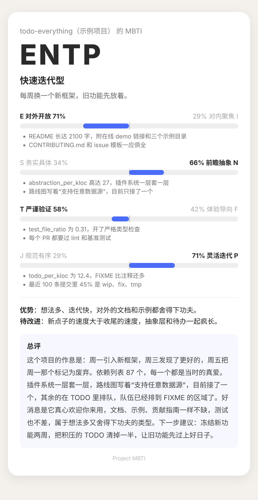

# project-mbti

想给你的项目做一次 MBTI 测试吗？

把项目交给它，几分钟后你会拿到一张结果卡片：你的项目是 16 种类型里的哪一种，凭什么，以及一段毫不留情但很有爱的总评。

> 你的项目是 **ENTP 快速迭代型**：每周换一个新框架，旧功能先放着。

<p align="center">
  
</p>

<p align="center"><sub>示例卡片，项目为虚构</sub></p>

## 测什么

四个维度，全部来自项目的代码、文档和提交记录：

| 维度 | 一边 | 另一边 |
|---|---|---|
| E / I | 对外开放：文档示例齐全，欢迎来用 | 对内聚焦：依赖少文档少，自给自足 |
| S / N | 务实具体：先把眼前的问题解决 | 前瞻抽象：先把框架搭到三年后 |
| T / F | 严谨验证：测试、类型、lint 一个不少 | 体验导向：报错友好，README 有温度 |
| J / P | 规范有序：CI、changelog、版本号齐全 | 灵活迭代：TODO 满天飞，想到哪写到哪 |

## 16 种项目类型

| 类型 | 名称 | 一句话 |
|---|---|---|
| INTJ | 深度架构型 | 架构图画了三版，README 一个字没写。 |
| INTP | 实验探索型 | 核心算法优雅得很，版本号永远停在 0.x。 |
| ENTJ | 工程治理型 | 流程、规范、CI 一个不少，合并要过五道关。 |
| ENTP | 快速迭代型 | 每周换一个新框架，旧功能先放着。 |
| INFJ | 体验打磨型 | 连报错信息都在温柔地安慰你。 |
| INFP | 愿景驱动型 | 愿景写得感人肺腑，实现还在路上。 |
| ENFJ | 生态布道型 | 文档、示例、教程齐全，生怕你用不明白。 |
| ENFP | 创意发散型 | README 里全是感叹号，功能清单比代码还长。 |
| ISTJ | 稳健可靠型 | 每个函数都有测试，每个版本都有 changelog。 |
| ISFJ | 稳定兜底型 | 没人注意到它，但它从不出错。 |
| ESTJ | 制度严明型 | lint 不过不许合并，格式不对不许提交。 |
| ESFJ | 社区共建型 | 贡献指南写得比业务代码还用心。 |
| ISTP | 精简实干型 | 没有文档，没有注释，但跑得飞快。 |
| ISFP | 细节手作型 | 界面很好看，目录结构全凭心情。 |
| ESTP | 快速交付型 | 提交信息只有 fix，先上线再说。 |
| ESFP | 展示驱动型 | 演示惊艳全场，一看代码全是硬编码。 |

## 你会得到什么

- 项目类型和四个维度的倾向，每个维度附带证据
- 一张可以分享的结果卡片
- 优势、待改进，以及一段有梗的总评
- 想玩更大的：让两个项目配对，看看前端和后端合不合得来

## 开始

1. 将 `SKILL.md` 及 `scripts/`、`references/` 目录添加为 Claude skill。
2. 打开一个项目，说：“给这个项目做 MBTI 评估”。
3. 想看配对？说：“测一下这两个项目合不合。”

课程作业、方案文档这类没有代码的项目，同样可以测。

## 目录

```
SKILL.md                 评估流程与规则
scripts/collect.py       客观信号统计
scripts/render_card.py   结果卡片生成
references/types.json    16 种项目类型
assets/example-card.png  README 里的示例卡片
```

## License

MIT
